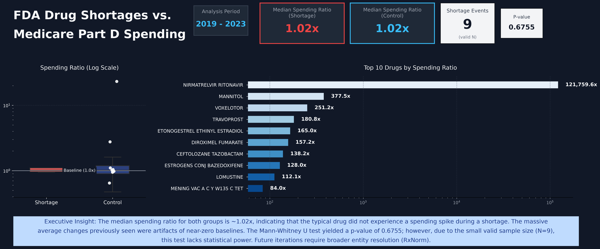

# FDA Drug Shortages vs. Medicare Part D Spending (2019–2023)




## Executive Summary

When a generic drug goes into shortage, prescribers often switch to alternatives that may cost more. That shift could show up in Medicare Part D spending. This project tests whether drugs that entered an FDA shortage grew or shrank differently, year over year, compared to drugs that never appeared in the shortage database.

The pipeline matched 10 FDA shortage events to CMS spending records. Nine had the prior-year data needed to compute a year-over-year ratio. The difference between the two groups is not statistically significant (Mann-Whitney U, p = 0.6755).

With only nine events, the test has very little statistical power. A high p-value here means the data cannot tell the two groups apart. It does not prove that shortages have no effect on spending; it simply means this dataset is too small to isolate it.

## Business Question

Do drug shortages change Medicare Part D spending, and if so, by how much?

## Methodology

1. **Data sources**
   - FDA Drug Shortages: first-posted dates for each generic drug in shortage.
   - CMS Medicare Part D Spending by Drug: annual spending, 2019 to 2023.
2. **Cleaning and matching (Python / Pandas)**
   - Normalized generic names using regex (removing dosage forms, salts, and punctuation) to join the two distinct datasets.
   - Filtered the CMS data to include only the `Overall` manufacturer rows to prevent double-counting, then aggregated to one row per generic per year.
3. **Analytical layer (PostgreSQL)**
   - Used CTEs to define the shortage group and the control group (generics with no shortage record).
   - Applied the `LAG` window function to calculate the year-over-year ratio: current year spending divided by prior year spending.
   - Limited events to 2020–2022, ensuring each has at least one year before and one year after.
4. **Statistics (SciPy)**
   - Chose the Mann-Whitney U test because it works on ranks, meaning a few extreme values do not dominate the result the way they would with a t-test.
   - Used medians as the primary summary statistic. Means are shown only for reference, as a handful of drugs with near-zero baselines push them far off.

## Key Findings

- We matched 10 shortage events to CMS records. Nine had a non-zero baseline and were included in the final analysis.
- There is no statistically significant difference between the groups (p = 0.6755).
- The mean is not a reliable metric here. A few drugs with very small baseline spending show ratios in the thousands, which distort the group averages.

## Limitations

- The sample size is too small (nine events) to detect a moderate effect. The result is inconclusive.
- Joining on generic names misses drugs with inconsistent labels. Fuzzy matching (RapidFuzz) or RxNorm identifiers would likely recover more matches.
- Drugs with no shortage record are a rough comparison group. They differ from shortage drugs in therapeutic class, market size, and competition, and none of that is controlled for.
- CMS data ends in 2023, so later shortage events have little post-shortage data.

## Next Steps

- Match drugs on RxNorm identifiers instead of name strings.
- Build a matched control group using therapeutic class and baseline spending.
- Model the log of the spending ratio to handle skew more directly than a rank test.

## Tech Stack

- Languages: Python, SQL
- Data: Pandas 3.1.1, NumPy
- Statistics: SciPy (`mannwhitneyu`)
- Visualization: Matplotlib, Seaborn
- Database: PostgreSQL 15, psycopg2
- Environment: Linux, Jupyter Lab, Git

## Reproducing the Project

```bash
git clone https://github.com/rodrigo-villalba-data/fda-shortages-medicare.git
cd fda-shortages-medicare
python3 -m venv .venv && source .venv/bin/activate
pip install -r requirements.txt
cp .env.example .env   # set DATABASE_URL
